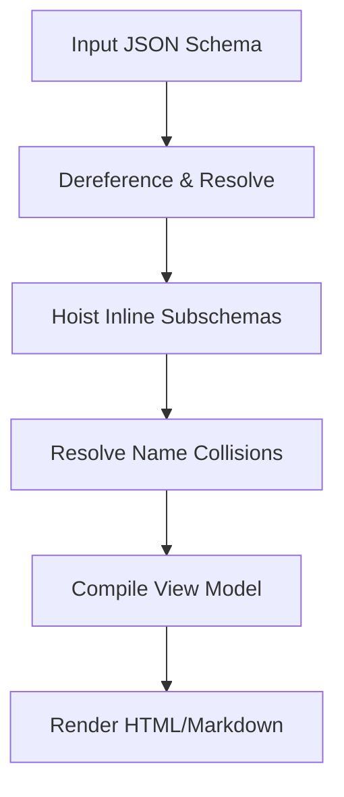

# Design Overview

Beryl is a schema documentation generator designed to transform JSON Schema files into clean, readable Markdown or HTML documents. 

Rather than rendering deep inline object trees—which quickly becomes unreadable in document form—Beryl hoists nested inline subschemas into a global definitions section.

## Architecture Pipeline

Beryl processes a schema through a simple, linear pipeline of steps:

### 1. Dereferencing
The schema is resolved using `@apidevtools/json-schema-ref-parser` to expand external references, creating a fully resolved syntax tree.

### 2. Hoisting
Beryl recursively traverses the schema. Any inline object schemas containing structural properties beyond basic metadata are hoisted to the root schema's `$defs` collection. The inline schema is replaced with a local `$ref` pointer.

### 3. Collision-Resistant Naming
Because inline schemas are automatically hoisted, naming collisions can occur (for example, if two different objects both define a nested field named `resolvers`). Beryl performs a frequency analysis on the generated names and dynamically appends parent context (e.g., `Resolvers (Grant)`) to distinguish collisions, leaving unique names clean.

### 4. View Model Compilation
The resolved and hoisted schema is translated into an intermediate view-model format. This keeps the rendering templates simple, data-driven, and free of processing logic.

### 5. Template Rendering
The compiled view model is passed to Pug templates, which generate the final output structure.

## Core Principles

- **Readability First**: Keep nesting levels to a minimum in the final document to make schemas easy for developers to scan.
- **Separation of Concerns**: Keep formatting rules, data retrieval, and page templates distinct.
- **Immutable/Isolated Mutations**: The schema tree mutation is encapsulated within an isolated traversal context (`Hoister`) to avoid unexpected side effects.
